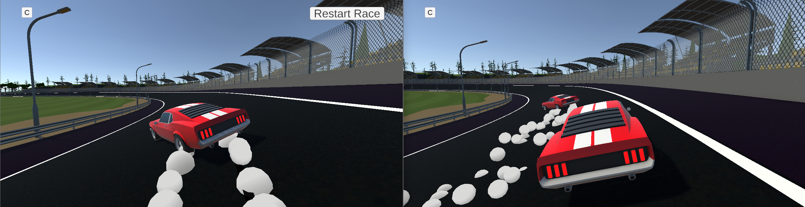

# Project deliverable: first iteration - Multiplayer Racing Game (UDP)
**Subject:** Xarxes i Jocs Online  
**Unity Version:** 6000.3.16f1  
**GitHub Repository:** [https://github.com/Jowy02/Xarxes-i-jocs-online](https://github.com/Jowy02/Xarxes-i-jocs-online)  
**VideoDemo:** [https://youtu.be/Z4KymsTZbOk](https://youtu.be/Z4KymsTZbOk)

---

## 🚀 1. How to Play & Test (Execution Guide)

### Setup & Requirements
* Download the executable `.exe` from the latest GitHub Release or build it directly from Unity.
* The game must be tested on two separate PCs over a local network (LAN / Wi-Fi) or locally on one PC by launching two instances.
* Port used: `9050` (UDP).

> ⚠️ **CRITICAL NOTES FOR UNITY EDITOR SETUP:**  
> 1. Copy and replace the `EditorBuildSettings.asset` file inside your project's `ProjectSettings` folder, and then open the `LobbyUDP` scene.  
> 2. Change player input settings to **Both**: navigate to `Edit` → `Project Settings` → `Player` → `Other Settings` → `Active Input Handling` and set it to **Both**.

### Step-by-Step Instructions:
1. **Host:**
   * Launch the build.
   * Click on **On-line Race** button to access multiplayer functionality (`LobbyUDP`).
   * Enter your player name in the input field.
   * Click **"Host Game"**. The UDP server starts listening on port `9050`, and a local client automatically connects. Your role will display as **Host**.
2. **Client:**
   * Launch the build on the second machine.
   * Click on **On-line Race** button to access multiplayer functionality (`LobbyUDP`).
   * Enter your player name and the **Local IP of the Host** (e.g., `192.168.1.XX` on LAN, or `127.0.0.1` if testing on the same PC).
   * Click **"Join Game"**.
3. **Waiting Room (Lobby):**
   * Both players will see each other in the live player list and can exchange text messages using the integrated UDP chat.
4. **Starting the Race:**
   * The **Host** clicks the **"Start Race"** button.
   * A synchronized network command triggers all connected clients to load the circuit scene (`RaceTrack`) simultaneously.
5. **Race Keyboard Controls:**
   * **W / S**: Throttle / Reverse
   * **A / D**: Steer Left / Steer Right
   * **Space Bar**: Handbrake & Drift (triggers tire smoke particles and skid marks)
   * **C**: Toggle in-game race chat
   * **M**: Toggle in-game menu
5. **Race Controller Controls:**
   * **RT / LT**: Throttle / Reverse
   * **Joystick**: Steer Left / Steer Right
   * **Circle button**: Handbrake & Drift (triggers tire smoke particles and skid marks)
---

## 🗺️ 2. Main Scene Structure
* **Initial Scene:** `MainMenu`  
Serves as the main entry point of the game, providing access to the two main gameplay options: `Test Circuit`, which allows players to test the gameplay and track on local, and `On-line Race`, which transitions to the `LobbyUDP` scene to access multiplayer functionality.
* **Lobby:** `LobbyUDP`  
Handles the initial lobby setup, player connections, and core multiplayer functionality. Players can choose to **Host** a match, becoming the session leader and managing the game session, or **Join** a match to search for and connect to hosted sessions before the race begins. Essential multiplayer session data is preserved during the transition to `RaceTrack` to maintain session continuity.
* **Game Scene:** `RaceTrack`  
Contains the race environment, track layout, car spawning system, and in-game gameplay elements. It supports multiplayer racing as well as single-player testing using host-assigned player configurations. Gameplay features include car synchronization, in-game chat, and local turn indicators.

---

## 🌐 3. Replication Model

For our racing game we are using Passive Replication over UDP, with the server running at a 20 Hz tick rate (every 0.05s). This is how it works:

Each player drives and simulates their own car locally (PrometeoCarController, Rigidbody, WheelCollider) and sends their current state (MsgType.Transform) to the server 20 times per second. The server saves the latest state for each player and sends a single binary MsgType.Replication packet at 20 Hz to everyone. Remote cars have physics disabled (isKinematic = true) and simply smooth out the received positions and rotations using Vector3.Lerp and Quaternion.Slerp (snapping directly if the gap is over 8 meters).

### **Why we choose passive replication)**
* Unity physics (Rigidbody and WheelCollider) is not deterministic across different PCs and framerates. If we only sent player inputs (active replication), small collisions or frame differences would quickly cause cars to end up in completely different places on each screen.
* With passive replication, if a UDP packet gets lost or delayed, the next tick packet fixes the car's position automatically, so it’s better for our gameplay.
* Driving your own car feels responsive because there is no waiting for the server before turning or accelerating.

---

## ⚡ 4. Binary Protocol and Replication Packet

Lobby, chat, and race control messages (JOIN:, REJOIN:, PLAYERS:, ROSTER:, CHAT:, START_RACE:, RESTART_RACE:, START_COUNTDOWN:, PING:, SERVER_ACTIVE) are sent as UTF-8 text (MsgType.Text = 1).All gameplay data is sent in pure binary using MemoryStream, BinaryWriter, and BinaryReader. **Replication Packet Layout (MsgType.Replication = 5)**

### **Header (9 bytes)**
* **MsgType** (byte, 1 byte)
* **m_sequence** (int, 4 bytes) - increases by 1 every tick so clients can ignore old/out-of-order packets (if (sequence <= m_lastSequence) return;).
* **count** (int, 4 bytes) - The number of objects inside this packet.

### **Each Object Entry**
* **id** (int, 4 bytes) - shared network ID from LinkingContext.
* **action** (byte, 1 byte) - Create, Update or Destroy.
* **If action** == Destroy: only 5 bytes (id + action).
* **If action** == Create or Update:
  * **type** (byte, 1 byte) - prefab type (0 = Car, 1 = Nitro Pickup).
  * **Car fields** (CarNetObject / NetObject, 29 bytes):
    * **Position** (Vector3: 3 floats = 12 bytes)
    * **Rotation** (Vector3 Euler: 3 floats = 12 bytes)
    * **Drift state** (bool isDrifting = 1 byte, used to trigger remote tire marks and drift smoke)
    * **Skin ID** (int skinId = 4 bytes)
  * Total per car entry: **35 bytes**. With 12 players, a full packet is around 429 bytes.
  * **Nitro** pickup fields (BoostPickupNetObject, 12 bytes):
    * **Position** (Vector3: 3 floats = 12 bytes). Total per pickup entry: 18 bytes.
  * **Boost pickup** event (MsgType.Boost = 6, 5 bytes):
    * **MsgType** (1 byte) + pickup ID (int, 4 bytes), sent from the server to the player who collected a nitro pickup.

---

## ⚡ 5. Replication Manager and Dynamic Objects

LinkingContext: Stores a Dictionary<int, GameObject> mapping each network ID to its GameObject (Register, Find, Unregister), so we never use GameObject.Find() inside the 20 Hz loop.
NetObject / CarNetObject: Every networked prefab inherits from NetObject and implements its own Write and Read methods, so the manager does not need to know the internal fields of each prefab.

### **ReplicationManagerServer**
* Uses **MarkCreate**, **MarkUpdate**, and **MarkDestroy** to queue changes per tick (Create and Destroy overwrite Update for the same ID).
* Repeats **Create** and **Destroy** actions for 1 second (m_repeat) so important spawns or destroys don't get lost if a UDP packet drops.

### **Dynamic Objects During Gameplay**
* **Disconnected players:** If a player quits or times out mid-race, the server calls MarkDestroy(id) so their car is removed on every client.
* **Nitro power-ups (type = 1):** Spawned and destroyed dynamically during the race using MarkCreate and MarkDestroy so all players see the pickups appear and disappear when someone grabs them.

### **Client Reading (ReadPacket)**
* Drops packets with **sequence <= m_lastSequence**.
* **Destroys and unregisters** objects marked as Destroy (It will update the race lists and HUD if a car was destroyed).
* If a BoostPickup Update arrives before its **Create packet** (for example if Create was lost), the client spawns the pickup dynamically via OnPickupCreated and registers it in LinkingContext.
* Skips applying the server copy of the local player’s car so it never goes back and forward.
* Reads remote cars states and forwards them to RaceSpawner for Lerp smoothing and drift particle synchronization.

---

## ⚡ 6. Virtual UDP Connection

UDP is connectionless, so there is no built-in way to know who is connected or when someone has left. We built a virtual connection on top of it, using text messages (MsgType.Text) for the control flow and a few timers on both sides.

### **Connection**
1. The client sends JOIN:<name> to the server. When the server receives the first message from a new endpoint, it adds it to its list of known clients (m_knownClients) and starts tracking when it was last seen (m_lastSeen).
2. The server creates a UDPPlayer, assigns it a unique ID and replies with YOUR_ID:<id>. Repeated JOIN messages from the same endpoint are ignored, so a duplicated packet does not create two players.
3. The server broadcasts the updated PLAYERS: list and ROSTER: (ID, name and IP of every player) to everyone.
4. The client is only considered inside the lobby once it is running and has received its ID (GetLocalPlayerId() >= 0). Until then, the lobby UI shows "Connecting..." and, if nothing arrives after 5 seconds, "Connection Failed".
5. The host is also a normal client: it starts the server locally and connects to it through 127.0.0.1, so host and clients follow exactly the same code path.

### **Keep alive and timeouts**
* The client sends PING: every 1 second and the server answers with SERVER_ACTIVE.
* Server side: every message from a client (including Transform packets) refreshes its m_lastSeen. If a client is silent for more than 5 seconds, the server removes it (RemovePlayer).
* Client side: every SERVER_ACTIVE refreshes m_lastServerResponse. If 5 seconds pass without a response, the client considers the server lost and either starts host migration (during a race) or returns to the lobby.

### **Disconnection**
* Clean exit: the client sends LEAVE: right before closing the socket, so the server removes it immediately instead of waiting for the 5-second timeout. JOIN and LEAVE are sent directly through the socket, without going through the network simulator.
* Removing a player: the server deletes it from m_knownClients, m_lastSeen and m_players, calls MarkDestroy(id) if the race is running (so its car disappears on every client through the replication packet), and broadcasts the new PLAYERS: and ROSTER:.

### **Packet filtering**
* The server only sends replication packets to endpoints in m_knownClients (20 Hz tick).
* Each client only accepts packets coming from the server endpoint (from.Equals(m_serverEndPoint)), so packets from other sources are discarded.
* The sequence counter is reset (m_lastSequence = -1) every time the client connects or the race starts or restarts, so the client does not discard valid packets because of an old sequence number.

### **Why we did it this way**
* A virtual connection gives us the benefits we need (knowing who is in the lobby, detecting dropped players, assigning persistent IDs) while keeping UDP's low latency for the 20 Hz gameplay data.
* A simple 1-second ping with a 5-second timeout tolerates a few lost packets (the ping is repeated every second) without keeping dead players in the race for too long.
* Using the same ID for the lobby, the LinkingContext and the replication packets means a player is identified in the same way everywhere.

---

## 🏆 7. EXTRAS IMPLEMENTED

We wanted to deliver a polished and engaging multiplayer experience with greater depth and complexity, so we implemented several extra features:

1. **Hereditary Host:** Previously, whenever the host disconnected during a game, all players were disconnected, forcing the session to end. In this new version, we have implemented a host migration system that automatically assigns a new host when the current one disconnects. This allows the game to continue without interrupting the remaining players' experience.
   

2. **Unique Car:** Each player's car is now assigned a unique color based on their starting position. This makes it easier to identify and distinguish between players cars during a race, improving visibility and the overall multiplayer experience.
   

3. **Ingame UI:** We have redesigned the in-game interface, introducing new features and a cleaner layout. The buttons previously displayed in the middle of the screen have been replaced with drop-down menus, making the interface less intrusive and easier to navigate.
The new interface includes:

    * Chat: Press the C key to show or hide the chat window.
    * Menu: Press the M key to show or hide the menu. From here, players can leave the game, while the host also has access to the Restart Race button.

4. **Speedometer:** We have added a speedometer to the in-game interface, allowing players to monitor their vehicle's current speed in km/h. This provides useful real-time feedback while driving and makes the racing experience more immersive.

5. **Sound Effects:** Each car features engine and tire-skid sound effects, which can also be heard by other players depending on their distance from the vehicle. Nitro has its own dedicated sound effect; however, it is only played locally to avoid excessive noise for other players.

6. **Visual Standings:** Although a standings system was already implemented in the previous version, players could only see the final results once the race was over. We have improved this system by introducing real-time standings, allowing players to monitor everyone's progress throughout the race, including their current position and completed laps. 

7. **New lobby visuals:** We have maintained all the functionality of the previous lobby versions while giving it a completely new visual design. The updated layout makes it easier for players to understand where everything is located and interact with the available options. Additionally, the new visuals give the lobby a more distinctive identity and add a personal touch to the game.

8. **Controller Inputs:** We have added controller support, allowing players to choose between keyboard and controller inputs whenever they want. To prevent input conflicts, the game automatically switches between input devices rather than allowing both to control the car simultaneously. The system handles the following situations automatically:

    * Controller connected: The game switches to controller input, disabling keyboard controls for driving.
    * Controller disconnected during a race: The game automatically switches back to keyboard controls.
    * Controller reconnected: The game switches back to controller input.

---

## 🔄 8. Detailed Changes Since The Last Delivery

Compared with the previous delivery, this version introduces a multiplayer car race.

* **World State Replication architecture:**  Replaced the old transform messages with ReplicationManagerServer, LinkingCOntext, NetObject, CarNetObject and BoostPickupNetObject.

* **Packet ordering and loss handling:**  Added m_sequence and m_lastsequence to discard out of order packets and 1 second redundancy m_repeat for Create and Destroy actions.

* **Dynamic gameplay objects:**  Added server-managed Nitro Boost pickups on the racetrack that spawn, get collected, grant a speed boost and respawn every 8 seconds.

* **Host Migration and Exit Race:**  Added a host migration system, when the host disconnects or leaves voluntarily, keeping car positions, skins, network IDs, and local lap progress before running a synchronized 5 second resume countdown.

* **Reliability on race start/countdown:**  Added repeated broadcast with token duplication for START_RAC:, START_COUNTDOWN;, and RACE_START: so players do not get stuck under packet loss.

* **Network Simulator UI:**  Integrated NetSim with an in-game slider panel NetSimUI to test latency, jitter, and packet loss.

* **UI and Visuals:**  Added new visual assets, controls tutorial, speedometer, lap counter, direction indicators, in-race menu/chat and loops for menus.

* **Controller Inputs:**  Added new controller support, allowing players to choose between keyboard and controller inputs whenever they want.

* **UI Tutorial:**  At the beginning of the race, on-screen UI prompts guide the player through each input.

---

## 🐛 9. Known Bugs / Limitations
* When joining an online game, any messages sent or received remain visible in the chat even after leaving that session and joining a different one. This happens because the chat history is not properly reset when switching between game sessions. We plan to address this in a future update to ensure that each game session has its own independent chat.

* Although the boost system is fully functional and currently works without any issues, its implementation is still quite basic. The boost is activated for a fixed amount of time, meaning players cannot see how much boost time they have remaining or decide strategically when to use it. In the next version, we plan to introduce a more advanced boost system, including additional mechanics and its integration into the in-game interface. This will give players greater control over its use and improve the overall gameplay experience.

* Controller support is already implemented, but the current input system does not support progressive control over vehicle speed and movement. Both the triggers and analog sticks currently behave as binary inputs, similar to keyboard controls, rather than detecting different levels of pressure or stick displacement. This means that players cannot gradually accelerate, brake, or steer using the controller. We plan to improve this system in the next version providing smoother and more precise vehicle control and enhancing the overall driving experience.

* Currently, there is no penalty for driving off the track. As a result, in certain sections of the circuit, taking a shortcut across the terrain can be faster and more efficient than following the actual road. This can negatively affect race balance and encourage players to leave the track rather than follow the intended route.

### 9.1- Bugs by jitter, latency and packet loss
* **High Packet Loss:** When packet loss reaches approximately 35% or higher, there is a possibility that the server will disconnect the affected player from the game.  Additionally, if packet loss increases by 20% or more before the host starts the race, the tutorial may fail to appear, preventing the race from starting. The host can attempt to resolve this issue by repeatedly restarting the race until the tutorial is displayed correctly and the race can begin.

* **Hosting and Joining Sessions:** Similar issues can occur when attempting to host or join an online game. If packet loss is too high, the connection attempt may fail. Even if the player manages to connect successfully, they may eventually be disconnected due to the high packet loss, as explained above.

* **High Latency:** Players experiencing high latency will perceive the game world with a noticeable delay compared to players with more stable connections. As a result, their experience of ongoing events will be slightly behind what other players are currently experiencing.

* **High Jitter:** Players experiencing high jitter may notice other players' vehicles shaking or moving inconsistently. At the same time, other players may see the affected player's vehicle behaving erratically, with sudden movements or visual stuttering.

---

## 👥 10. Team Members & Contributions

* **Ana Alcaraz ([Audra0000](https://github.com/Audra0000)):**  
  Worked on:

* **Arthur Cordoba ([000Arthur](https://github.com/000Arthur)):**  
  Worked on:

* **Haosheng Li ([HaosLii](https://github.com/HaosLii)):**  
  Worked on: 

* **Pablo Sanjose ([XXPabloS](https://github.com/XXPabloS)):**  
  Worked on:

* **Joel Vicente ([Jowy02](https://github.com/Jowy02)):**  
  Worked on:
