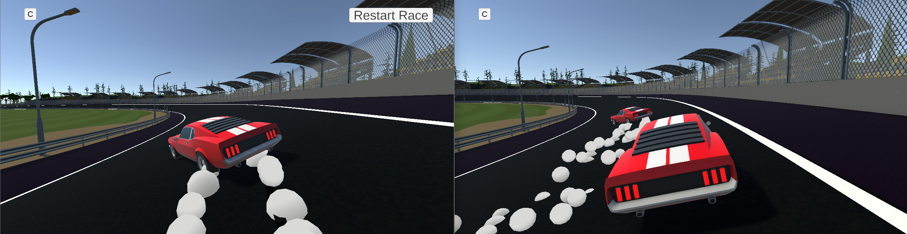
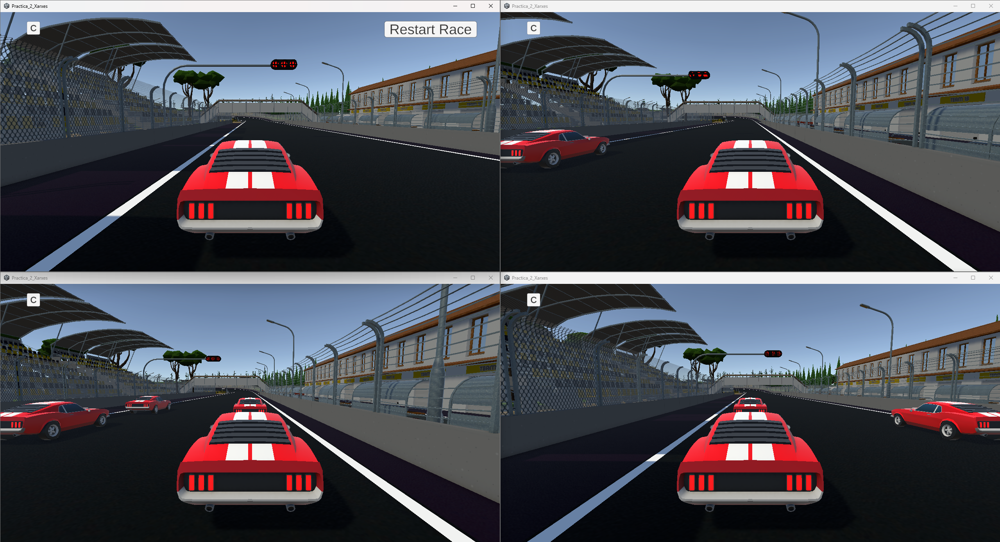
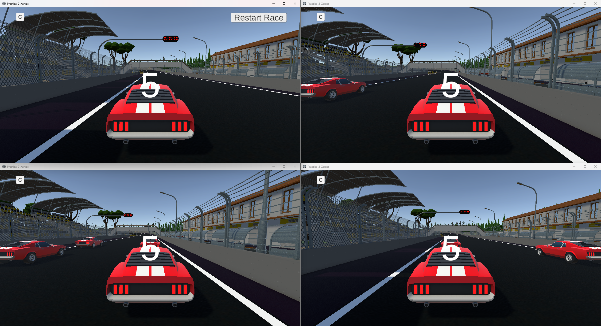
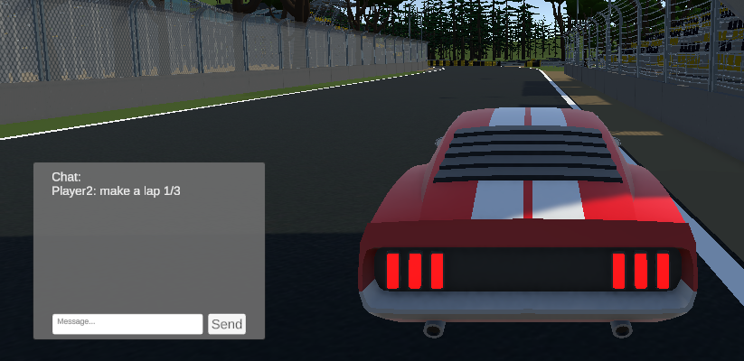

# Project deliverable: first iteration - Multiplayer Racing Game (UDP)
**Subject:** Xarxes i Jocs Online  
**Unity Version:** 6000.3.16f1  
**GitHub Repository:** [https://github.com/Jowy02/Xarxes-i-jocs-online](https://github.com/Jowy02/Xarxes-i-jocs-online)  
**VideoDemo:** [https://youtu.be/Z4KymsTZbOk)  
---

## 🚀 1. How to Play & Test (Execution Guide)

### Setup & Requirements
* Download the executable `.exe` from the latest GitHub Release or build it directly from Unity.
* The game must be tested on two separate PCs over a local network (LAN / Wi-Fi) or locally on one PC by launching two instances.
* Port used: `9050` (UDP).

### Step-by-Step Instructions:
1. **Host:**
   * Launch the build.
   * Enter your player name in the input field.
   * Click **"Host Game"**. The UDP server starts listening on port `9050`, and a local client automatically connects. Your role will display as **Host**.
2. **Client:**
   * Launch the build on the second machine.
   * Enter your player name and the **Local IP of the Host** (e.g., `192.168.1.XX` on LAN, or `127.0.0.1` if testing on the same PC).
   * Click **"Join Game"**.
3. **Waiting Room (Lobby):**
   * Both players will see each other in the live player list and can exchange text messages using the integrated UDP chat.
4. **Starting the Race:**
   * The **Host** clicks the **"Start Race"** button.
   * A synchronized network command triggers all connected clients to load the circuit scene (`RaceTrack`) simultaneously.
5. **Race Controls:**
   * **W / S**: Throttle / Reverse
   * **A / D**: Steer Left / Steer Right
   * **Space Bar**: Handbrake & Drift (triggers tire smoke particles and skid marks)
   * **Chat Button On Sceen**: Toggle in-game race chat

---

## 🗺️ 2. Main Scene Structure
* **Initial Scene:** `LobbyUDP`  
Handles the initial lobby setup, player connections, and core multiplayer functionality. Players can choose to **Host** a match, becoming the session leader and managing the game session, or **Join** a match to search for and connect to hosted sessions before the race begins. Essential multiplayer session data is preserved during the transition to `RaceTrack` to maintain session continuity.
* **Game Scene:** `RaceTrack`  
Contains the race environment, track layout, car spawning system, and in-game gameplay elements. It supports multiplayer racing as well as single-player testing using host-assigned player configurations. Gameplay features include car synchronization, in-game chat, and local turn indicators.

---

## 🌐 3. Network Architecture: State vs Input
We send state, not input.
* **Input Synchronization:**
Not used. Keyboard inputs (W/A/S/D/Space) are only processed locally by PrometeoCarController and are never sent. Only discrete events (START_RACE:, RESTART_RACE:, CHAT:, LEAVE:) travel as text messages.
* **State Synchronization:**
Each client simulates its own car locally and sends its resulting state (ID, position, rotation and drift flag) in a 30-byte binary packet at 20 Hz. The server relays it to the other clients, where the remote car is kinematic and smoothly interpolated towards the received state.

### **Why State?**
- No physics divergence: Rigidbody physics is not deterministic across machines, so simulating other players’ inputs locally would make cars drift apart.
- Tolerant to packet loss: a lost packet is harmless because the next one (50 ms later) contains the full up-to-date state.
- Simple and cheap: no lockstep or rollback is needed, and 30 bytes at 20 Hz is affordable for up to 12 players.
---

## ⚡ 4. Latency Mitigation & Reliable Messaging

### A. How We Keep Lag Low:
1. **Compact Binary Serialization:**  
   We eliminated JSON and text for gameplay. Using our custom `NetworkSerializer` (`MemoryStream`, `BinaryWriter`, and `BinaryReader`), the vehicle's transform and drifting state are packed into **exactly 30 bytes**:
   **Type (1B) + ID (4B) + Position (12B) + Euler Rotation (12B) + Drift (1B) = 30 Bytes** 

   Compared to standard JSON (~95 bytes), this is a **~68% bandwidth reduction**, we lower the socket buffer overhead and serialization latency.
3. **Fixed Rate Update (20 Hz):** Updates are with a delta timer (`0.05s`) rather than on every graphic frame (`Update()`), preventing socket saturation and packet queuing on high refresh rate displays (144 Hz or more).
4. **Client-Side Interpolation (Jitter Removal):** Remote vehicles do not snap abruptly to raw network coordinates, they smoothly interpolate position and rotation using `Vector3.Lerp` and `Quaternion.Slerp`, masking network jitter and frame discrepancies.

### B. Ensuring Important Messages Arrive (Reliability over UDP):
As not all data in game has the same importance, we treat it differently:

* **Car Movement:** Positions are sent 20 times per second. If a packet gets lost, it doesn't matter, we don't resend it. 50 ms later a newer positions arrives and fixes it. Resending old positions would only create more lag.
* **Important Messages (Start, Lap, Restart, Lobby):**  
Events like `START_RACE:`, `RESTART_RACE:`, `LAP:`, `YOUR_ID:` only happen once. So to make sure they don't get lost:
  *  We keep a **PING heartbet every 1 second** so the router's NAT table never closes the connection.
  * The server always replies to the exact address provided by `ReceiveFrom`, avoiding NAT routing errors.
  * We tried to replicate the **ACK ackowledgment system**, where the sender repeats the important message until the receiver sends back confirmation.

---

## 🏆 5. EXTRAS IMPLEMENTED

We wanted to deliver a polished and engaging multiplayer experience with greater depth and complexity, so we implemented several extra features:

1. **Full 3D Elevation & Banked Movement (Pitch, Yaw, Roll):** Our vehicle controller supports full 3D movement, allowing it to navigate elevation changes, ramps, jumps, and banked turns. Its rotation system supports pitch, yaw, and roll, enabling realistic vehicle orientation and dynamic movement on the ground. Other player will see all this movements as u do.

2. **Synchronized Car Action: Drifting:** In addition to the previously mentioned features, the vehicle supports drifting, adding depth and complexity to the driving mechanics. Drifting generates smoke particles from the tires, enhancing visual realism and providing clear feedback on the vehicle's movements. Other players can see both the drifting behavior and the particle effects generated by drifting, braking, and sharp turns.

3. **Multiplayer Scalability (>2 Players):** The lobby supports an unlimited number of players. However, once the host starts the race, a maximum of 12 players can participate. Each player is assigned a starting position on the race grid based on their position in the lobby, ensuring an organized starting lineup. The system supports races with any number of players within this range.

4. **Environment & Car-to-Car Solid Collisions:** Both the vehicles and the race track feature collision detection, allowing us to define track boundaries and customize the racing environment. Additionally, players can collide with one another, enabling physical interactions between vehicles and adding a more dynamic and engaging multiplayer racing experience.
   
5. **Synchronized 5-Second Countdown:** When the host starts the race from the lobby, all players are teleported to their assigned starting positions on the race grid. Once every player is in position, the server initiates a synchronized five-second countdown that is displayed to all players. During this countdown, vehicle movement is disabled, preventing players from moving before the race officially begins. Once the countdown reaches zero, movement is enabled for all players simultaneously.

6. **Full Game Loop (Lap Detection & Win Condition):** The race track features invisible checkpoints that ensure players complete each lap correctly. Whenever a player completes a lap, a message is displayed in the global chat showing their progress and the number of laps remaining to win the race.
  
    The race consists of three laps. When a player crosses the finish line after completing all three laps, they are declared the winner, and a 30-second countdown begins. This countdown is displayed on every player's screen, giving the remaining participants time to finish the race. Once the countdown reaches zero, the race ends automatically, and all players are returned to the lobby. In the lobby, a leaderboard displays the players who completed the race, ranked by their best completion times.

   
7. **Host Race Restart System:** Once the race has started, the host can restart it at any time if an issue occurs. This will reset every player's lap progress and return all players to their assigned starting positions on the race grid. Once everyone is back in position, the server initiates the synchronized five-second countdown.

---

## 🔄 6. Detailed Changes Since The Last Delivery

Compared with the previous delivery, this version introduces a multiplayer car race.

- **Lobby to race transition:** The host can request a race start from the lobby. The server distributes the participant IDs and clients load `RaceTrack` while keeping their network connections active.

- **Player identification and starting grid:** The server assigns each player a unique ID. Each client creates one car per participant, using the same player list and spawn point order. Car creation supports multiple participants, currently with a maximum of 12.

- **Local controls and camera:** Each player controls only their own car and their camera follows it. Input controllers are disabled on remote cars.

- **Binary vehicle serialization:** Car movement replaces the previous JSON position messages with `NetworkSerializer`. Each 30-byte payload contains the message type, object ID, three position values, three Euler rotation values and a drifting flag. Pitch, yaw and roll are transmitted, allowing remote cars to reproduce slopes and banked turns.

- **Networked car movement:** Cars replace the previous capsule minigame. Each client sends its car state approximately 20 times per second over UDP. The server forwards these updates to the other clients, which smoothly move and rotate the corresponding remote cars towards the received state.

- **In-race chat:** The UDP chat is available in `RaceTrack`, so players can communicate without returning to the lobby. Race announcements and results also use the chat log.

---

## 🐛 7. Known Bugs / Limitations
* If a player disconnects abruptly by force-closing the game window (Alt+F4) without using the disconnect option, their car will remain stationary on the track until the server's 5-second timeout cleans it up.
* Severe packet loss caused by an unstable Wi-Fi connection may result in interpolation drift, causing cars to appear to slide around corners until the next packet arrives.
* The in-game chat does not adapt to different screen resolutions or aspect ratios and needs further visual refinement.
* Lap counts should be displayed in the main UI rather than only in the chat.
* Game loop and lobby navigation require further improvements. Server disconnection, lobby exit, and return-to-main-menu functionality are not yet fully implemented.

---

## 👥 8. Team Members & Contributions

* **Ana Alcaraz ([Audra0000](https://github.com/Audra0000)):**  
  Worked on:
  * Ported the UDP chat system (originally developed by Joel for the lobby) and its Canvas UI to the `RaceTrack` scene.
  * Added the `RaceChatUI` script to adapt the chat to the race scene.
  * Race-end flow: 30 second countdown after the first winner, then all players return to the waiting room.
  * Post-race results: final standings and fastest lap shown in the lobby chat.

* **Arthur Cordoba ([000Arthur](https://github.com/000Arthur)):**  
  Worked on:
  * Initial UDP-based chat system for lobby and in-game player communication.
  * Local turn indicator UI system with trigger-based activation.
  * Design and creation of 2D textures for directional arrows.
  * Map collision and track boundary improvements.
  * Asset placement adjustments.

* **Haosheng Li ([HaosLii](https://github.com/HaosLii)):**  
  Worked on: 
  * Improved the UDP lobby interface.
  * Player ID assignment and distribution of the race participant list.
  * Spawning one car per player at the assigned starting position.
  * Sending local car states and applying received updates to remote cars.

* **Pablo Sanjose ([XXPabloS](https://github.com/XXPabloS)):**  
  Worked on:
  * RaceTrack Scene and built the circuit.
  * Start Race Button for host and the synchronized scene loading trigger.
  * Starting grid spawn points car system.
  * Capsule Minigame removed.
  * Fix on serialization and Capsule Minigame removed, replacing JSON text with native binary serialization.
  * Jitter Removal with Vector3.Lerp and Quaternion.Slerp interpolation.
  * Restart Race functionality.
  * Drift Marks.

* **Joel Vicente ([Jowy02](https://github.com/Jowy02)):**  
  Worked on:
  * Integrated Prometheus car asset and adapted the vehicle controller script.
  * Camera control script.
  * UDP chat system for both the lobby and in-game communication, including code and Canvas UI.
  * First iteration of message serialization using JSON, including message type identification.
  * Lap counter and race-winning conditions.
  * Removal of disconnected players' cars from the other players' scenes.
  

